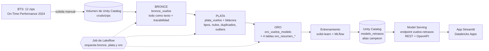

# ¿Se retrasará mi vuelo? Pipeline medallion y modelo publicado en Databricks

**Autor:** <<TU NOMBRE>> · Proyecto final de Big Data · Noviembre de 2026

Este proyecto predice si un vuelo comercial doméstico de EE.UU. llegará con **15 minutos o más de retraso**,
usando solo información que se conoce antes del despegue (mes, día de la semana, horarios programados,
distancia, aerolínea, origen y destino). Procesa los **12 meses de 2024 del BTS (unos 7 millones de vuelos)**
con PySpark en una arquitectura **medallion (bronce, plata, oro)** sobre tablas Delta en **Databricks Free
Edition**, orquestada con un **Job de Lakeflow**. El modelo (clasificación binaria, métrica principal F1 de la
clase "retrasado") se registra en **Unity Catalog**, se publica como un **endpoint REST de Model Serving** con
contrato documentado en OpenAPI y validación de entradas, y lo consulta una **aplicación Streamlit** (Databricks
Apps) que maneja errores, tiempos de espera y respuestas inválidas.

## Pendientes antes de entregar

> **Esta sección es solo para ti: bórrala completa antes de entregar el repositorio.**

Marcadores que debes reemplazar con resultados de tu propia corrida (búscalos con `<<`). **No debe quedar ninguno.**

- [ ] `<<TU NOMBRE>>` (arriba)
- [ ] Datos: número de filas de bronce y por archivo (`<<PEGAR: ...>>` en la sección "Los datos")
- [ ] 1. Limpieza: bitácora de calidad en Markdown (salida del notebook `02_plata`) y balance de clases de `03_oro`
- [ ] 1. Limpieza: captura de las tablas medallion en Catalog
- [ ] 2. Problema y métrica: tabla de resultados (bloque `RESUMEN PARA EL README` del notebook `04_entrenamiento`) y captura de la matriz de confusión y la curva precisión-recall
- [ ] 3. Publicación: tabla de pruebas en vivo del notebook `05_publicar_endpoint` y captura del endpoint **Ready**
- [ ] 3. Publicación: archivo `docs/openapi.json` generado y captura de la especificación
- [ ] 4. Aplicación: capturas de predicción, entrada inválida y modo de falla
- [ ] Orquestación: captura del Job y de una ejecución exitosa
- [ ] Revisar que el diagrama Mermaid y las tablas se vean bien en GitHub

## Arquitectura



| Pieza | Tecnología |
|---|---|
| Plataforma | Databricks Free Edition (cómputo serverless, Unity Catalog) |
| Procesamiento | PySpark, tablas Delta, arquitectura medallion |
| Orquestación | Job de Lakeflow: 3 tareas encadenadas con horario |
| Modelo | Pipeline de scikit-learn (escalado + codificación + clasificador) dentro de un `mlflow.pyfunc` que valida entradas |
| Publicación | Model Serving (REST, CPU, escala a cero) |
| Aplicación | Streamlit en Databricks Apps, cliente REST con reintentos |

## Los datos

* **Fuente:** BTS (Bureau of Transportation Statistics, EE.UU.), "Reporting Carrier On-Time Performance", los 12
  meses de 2024. Cada vuelo programado es un registro, con 109 columnas.
* **Volumen:** unos 630 mil vuelos por mes, **aproximadamente 7 millones en el año** (el requisito del curso es
  4 millones o más). Cifra exacta de bronce: <<PEGAR: número de filas de bronce y tabla de filas por archivo del notebook 01_bronce>>.
* **Ingesta:** los 12 zips se descargan en la laptop (`datos/descargar_zips.ps1`) y se suben a un volumen de Unity Catalog
  (`/Volumes/<catálogo>/vuelos/crudo/zips`), porque Free Edition restringe la salida a internet. El notebook `01_bronce`
  descomprime cada zip, lo carga a Delta y borra el CSV temporal.
* **Particularidades:** todo llega como texto (horas `0700`, números `1.00`), la etiqueta `ArrDel15` viene vacía
  exactamente en los vuelos cancelados o desviados, y cada línea termina en coma (columna fantasma al final).

## 1. Limpieza y transformación (rúbrica: 35 puntos)

Metodología por capas. Cada decisión de plata queda registrada con filas antes y después, y su justificación.

### Bronce (`notebooks/01_bronce.py`)

| Decisión | Por qué |
|---|---|
| Todas las columnas como texto (`STRING`) | Bronce no interpreta los datos; ningún valor raro se pierde en la carga |
| Columnas `_archivo_zip`, `_ruta_origen`, `_fecha_ingesta` | Trazabilidad: de qué archivo salió cada fila y cuándo se cargó |
| Carga incremental (un zip ya cargado no se recarga) | El notebook se puede correr varias veces o programar como job sin duplicar filas |
| Se descarta la columna vacía del final | Es un artefacto de la coma final de cada línea |
| Verificación de al menos 4,000,000 de filas | Requisito del proyecto, comprobado con un `assert` |

### Plata (`notebooks/02_plata.py`)

De las 109 columnas se conservan 33 (se descartan identificadores redundantes y las 48 columnas de desvíos `Div*`, vacías en más del 99 % de los vuelos).

| Aspecto | Decisión | Justificación |
|---|---|---|
| **Tipos de dato** | Conversión con `try_cast`; los valores no convertibles pasan a `NULL` y se cuentan | El cómputo serverless usa modo ANSI: un `CAST` inválido detiene el proceso. Así el valor inválido se registra en vez de colarse como dato falso |
| **Nulos críticos** (fecha, aerolínea, ruta, horarios, distancia, duración programada, cancelado, desviado) | Se elimina la fila | Sin ellos no se identifica el vuelo ni se puede usar para predecir |
| **Nulos en las 5 causas de retraso** | Se rellenan con 0 en vuelos no cancelados | El BTS solo reporta causas si el vuelo llegó 15 min o más tarde; ahí el nulo equivale a 0 minutos |
| **Nulos en matrícula y código de cancelación** | Categorías `DESCONOCIDA` y `NA` | Son identificadores o categorías, no se pueden estimar |
| **Nulos en la etiqueta** (`ArrDel15`, retraso de llegada, horas reales) | Se dejan como `NULL`, no se imputan | Solo ocurren en vuelos cancelados o desviados. Imputar la variable objetivo sería inventar el resultado; se excluyen del modelo en oro |
| **Duplicados exactos** | Se eliminan | Una fila idéntica contaría dos veces el mismo vuelo |
| **Duplicados por llave** (fecha, aerolínea, número de vuelo, origen, destino, hora programada) | Se conserva una fila por vuelo | Un vuelo es un solo evento; duplicarlo sesgaría conteos y entrenamiento. La revisión se registra aunque dé 0 |
| **Valores imposibles** (7 reglas de dominio: fecha incoherente con año y mes, mes o día fuera de rango, hora HHMM inválida, distancia fuera de 0 a 6,000 mi, duración fuera de 15 a 900 min, velocidad implícita fuera de 40 a 700 mph, origen igual a destino) | Se eliminan | Son errores de captura, no vuelos raros |
| **Outliers estadísticos** (retrasos largos) | **No se eliminan**; se acotan a los percentiles 0.1 y 99.9 en una columna nueva (`retraso_llegada_min_acotado`) | La regla IQR marcaría como atípica a una parte importante de los vuelos, y son justo los retrasos reales que se quiere predecir. El acotado solo sirve para que los promedios de oro no dependan de unos cuantos casos. La etiqueta binaria no cambia |

### Oro (`notebooks/03_oro.py`)

| Decisión | Por qué |
|---|---|
| `oro_vuelos_modelo`: un renglón por vuelo operado, 9 variables + `retrasado` + `conjunto` | Tabla lista para entrenar, sin más limpieza |
| Se excluyen cancelados y desviados | No tienen retraso de llegada: la etiqueta no existe |
| Solo variables conocidas **antes del despegue** | Evita fuga de información (el retraso de salida predice muy bien el de llegada, pero no se conoce al consultar con anticipación) |
| El día del mes no entra como variable | Con un solo año, el modelo memorizaría días específicos (tormentas, caídas de sistemas) que no se repiten |
| Columna `conjunto`: 1 de cada 5 **días** (hash de la fecha) es `prueba`, el resto `entrenamiento` | Separación por días completos: los vuelos de un mismo día comparten clima y saturación; mezclarlos al azar inflaría la métrica |
| 4 tablas `oro_resumen_aerolinea`, `_ruta`, `_hora`, `_mes` | Agregados para análisis y para probar la aplicación |

### Normalización y codificación

Se hacen en el **pipeline del modelo** (notebook `04_entrenamiento`, módulo `notebooks/_modelo.py`), no en las tablas:
las transformaciones se aprenden solo con los datos de ajuste y viven ahí a propósito: el mismo pipeline guardado en el modelo se aplica a cada
consulta del endpoint, así lo que se transforma en producción es idéntico a lo que se usó para entrenar. Se entrenan dos pipelines
(`construir_pipeline`) y gana el de mayor F1 en validación:

| Paso del pipeline | `logistica` (línea base) | `gradiente` |
|---|---|---|
| `escalado` (`StandardScaler`: media 0, desviación 1) | `distancia_millas` y `duracion_prog_min` | las 6 columnas numéricas (no cambia nada para los árboles, pero deja la misma estructura) |
| `codificacion_one_hot` (`OneHotEncoder`: una columna 0/1 por categoría; categorías con menos de 50 casos se agrupan en la logística) | aerolínea, origen, destino **y** mes, día de la semana y horas (su efecto no es lineal: las 18 h no son "3 veces" las 6 h) | solo `aerolinea` (15 categorías) |
| `codificacion_objetivo` (`TargetEncoder`) | no se usa | `origen` y `destino`: cada aeropuerto se resume en su tasa de retraso suavizada |
| `clasificador` | `LogisticRegression(class_weight="balanced")` | `HistGradientBoostingClassifier(class_weight="balanced", early_stopping=True)` |

* **Por qué normalizar:** la regresión logística es sensible a la escala; sin ello la distancia (cientos o miles de millas) dominaría a las horas (0 a 23).
* **Por qué codificar:** un modelo no usa texto, y numerar las categorías (AA=1, DL=2...) inventaría un orden que no existe.
* **Por qué `TargetEncoder` en los aeropuertos:** hay cientos de aeropuertos; con one-hot serían cientos de columnas casi vacías. El `TargetEncoder` usa validación
  cruzada interna para no filtrar la etiqueta al ajustarse.
* **`class_weight="balanced"`** da más peso a la clase minoritaria (vuelos retrasados) para que el modelo no se limite a decir "a tiempo".

Cuál de los dos modelos gana depende de la corrida: se reporta en el bloque `RESUMEN PARA EL README` de la sección 2.

### Bitácora de calidad (evidencia)

<<PEGAR: tabla Markdown que imprime la última celda del notebook 02_plata (9 renglones, de "| # | Paso |..." al final)>>

Balance de clases y tamaños de `oro_vuelos_modelo`: <<PEGAR: salida de la tabla de balance del notebook 03_oro: vuelos, días, retrasados y % por conjunto>>

<<CAPTURA: Catalog con las tablas bronce_vuelos, plata_vuelos, plata_bitacora_calidad, oro_vuelos_modelo y oro_resumen_*>>

## 2. Definición del problema y métrica (rúbrica: 10 puntos)

* **Tipo de tarea:** clasificación binaria supervisada. `retrasado = 1` si el vuelo llegó 15 minutos o más tarde.
* **Desbalance:** solo alrededor de 1 de cada 5 vuelos se retrasa (aproximadamente 18 a 25 %). Un modelo que siempre diga
  "a tiempo" tendría cerca de 80 % de exactitud sin servir para nada.
* **Métrica principal: F1 de la clase "retrasado".** Combina la precisión (de los vuelos que el modelo marca como retrasados, cuántos lo estuvieron)
  y el recall (de los vuelos retrasados, cuántos detecta). Vale 0 para el modelo trivial "siempre a tiempo".
* **Métricas que reporta `04_entrenamiento` en los días de prueba:** F1 (clase retrasado), precisión, recall, PR-AUC, ROC-AUC y exactitud,
  más la matriz de confusión (VN, FP, FN, VP). PR-AUC y ROC-AUC miden la calidad del ordenamiento sin depender del umbral; la exactitud se
  reporta solo para mostrar por qué engaña.
* **Líneas base ingenuas** (en la misma tabla): "siempre retrasado" (recall perfecto, precisión igual al porcentaje de retrasos; su F1 es el mínimo
  que un modelo útil debe superar) y "siempre a tiempo" (exactitud alta, F1 = 0).
* **Umbral y modelo se eligen en validación, no en prueba:** se compara una línea base logística con un modelo de gradiente
  (`HistGradientBoostingClassifier`); para cada uno se busca el umbral de probabilidad que maximiza F1 (con la curva precisión-recall), porque 0.5 casi nunca es el
  mejor en un problema desbalanceado. Gana el de mayor F1 en validación. El umbral queda guardado en el modelo (`umbral_decision`, constante por versión).
* **Evitar fuga de información:** solo entran variables conocidas antes del despegue; no se usa el retraso de salida ni ninguna causa de retraso.
* **Separación:** por **días completos**, no al azar. La prueba (1 de cada 5 días, columna `conjunto` de oro) no participa en ninguna decisión y se evalúa **una sola vez**;
  la validación también se separa por días dentro del entrenamiento (`GroupShuffleSplit` por `fecha_vuelo`), y el notebook comprueba con un `assert` que ningún día se repite.
* **Muestras:** como el cómputo de Free Edition es pequeño, el entrenamiento usa muestras aleatorias de la tabla oro (constantes `FILAS_ENTRENAMIENTO`,
  `FILAS_PRUEBA` y `FILAS_LOGISTICA` en `04_entrenamiento`); el bloque de resultados dice cuántos vuelos y días se usaron realmente.

Resultados (versión registrada como `campeon`). El notebook 04 imprime un bloque Markdown que empieza con `RESUMEN PARA EL README`; contiene la tabla
de métricas de prueba (modelo elegido vs. "siempre retrasado" vs. "siempre a tiempo"), el modelo elegido con su F1 en validación, el umbral, el tamaño de cada muestra,
el porcentaje de retrasos en prueba, la matriz de confusión y la versión registrada con el número de aerolíneas y aeropuertos conocidos:

<<PEGAR: bloque "RESUMEN PARA EL README" que imprime el notebook 04_entrenamiento (sin las líneas de guiones)>>

<<CAPTURA: matriz de confusión y curva precisión-recall de 04_entrenamiento (sección 5)>>

## 3. Publicación del modelo (rúbrica: 25 puntos)

El modelo se registra en **Unity Catalog** como `<catálogo>.vuelos.modelo_retrasos` (alias `campeon`) y se sirve en un
**endpoint gestionado de Model Serving** llamado `vuelos-retrasos` (REST, CPU, escala a cero), creado y actualizado
por el notebook `05_publicar_endpoint`.

**Petición**

```
POST https://<host-del-workspace>/serving-endpoints/vuelos-retrasos/invocations
Authorization: Bearer <token>
Content-Type: application/json

{
  "dataframe_split": {
    "columns": ["mes", "dia_semana", "hora_salida_prog", "hora_llegada_prog",
                "distancia_millas", "duracion_prog_min", "aerolinea", "origen", "destino"],
    "data": [[7, 5, 18, 21, 1947.0, 285.0, "DL", "ATL", "LAX"]]
  }
}
```

También acepta `dataframe_records`. Máximo 1,000 filas por petición.

**Respuesta correcta (HTTP 200)**

```json
{"predictions": [{"probabilidad_retraso": 0.3124, "retraso_predicho": 0, "umbral_decision": 0.41}]}
```

(Ejemplo del formato: los números dependen de la versión del modelo.) `retraso_predicho` es 1 si `probabilidad_retraso >= umbral_decision`.

**Validación de entradas, en dos capas**

1. **Firma de MLflow** (la aplica el servidor): columnas faltantes o tipos incompatibles se rechazan.
2. **Reglas de negocio** (dentro del modelo): rangos, categorías conocidas y coherencia. Son las mismas reglas de dominio de plata.

| Variable | Regla |
|---|---|
| `mes` | 1 a 12 |
| `dia_semana` | 1 a 7 |
| `hora_salida_prog`, `hora_llegada_prog` | 0 a 23 |
| `distancia_millas` | mayor que 0 y hasta 6,000 |
| `duracion_prog_min` | 15 a 900 |
| velocidad implícita | 40 a 700 mph |
| `aerolinea`, `origen`, `destino` | códigos presentes en los datos de entrenamiento; origen distinto de destino |

**Cómo se ve un rechazo.** El servidor de MLflow envuelve el mensaje del modelo. Para `mes=13`, la API envía HTTP 400 con este cuerpo
(la copia de los datos recibidos va en lugar de `...`):

```json
{"error_code": "INVALID_PARAMETER_VALUE", "message": "Failed to predict data '...'. \nError: Entrada inválida: fila 0: mes=13 fuera de rango (1-12)"}
```

La aplicación y el notebook 05 muestran solo la parte legible, a partir de `Entrada inválida:` (en este ejemplo, `Entrada inválida: fila 0: mes=13 fuera de rango (1-12)`).
Hay dos familias de error, ambas con HTTP 400:

| Qué falla | `error_code` | Mensaje |
|---|---|---|
| Regla de negocio (mes fuera de rango, aerolínea o aeropuerto desconocido, origen igual a destino, velocidad imposible, valor faltante, más de 1,000 filas) | `INVALID_PARAMETER_VALUE` | Envuelto; termina en `Entrada inválida: fila N: ...` (lista hasta 10 problemas) |
| Tipo incompatible o JSON mal formado (por ejemplo `mes="julio"`) | `BAD_REQUEST` | En inglés, generado por la firma de MLflow antes de llegar al modelo |

(El formato de este cuerpo se observó con el servidor real de MLflow en una prueba local; en Databricks lo confirma la sección 4.1 del notebook `05_publicar_endpoint`,
que imprime los cuerpos exactos de una respuesta correcta y de un error.)

**Documentación OpenAPI:** el notebook 05 descarga el esquema del endpoint y lo guarda siempre en el volumen y, si corre dentro del Git folder, en [`docs/openapi.json`](docs/openapi.json); si no, se descarga del volumen y se sube a esa ruta.
<<CAPTURA: especificación OpenAPI del endpoint (Serving > vuelos-retrasos, o el JSON abierto en un visor)>>

**Pruebas en vivo contra el endpoint:** el notebook 05 ejecuta 9 pruebas reales (2 vuelos válidos, uno de ellos con minúsculas y espacios, y 7 entradas inválidas:
tipo incorrecto, mes 13, aerolínea desconocida, aeropuerto desconocido, columna faltante, origen igual a destino y velocidad imposible). Cada una dice `PASA` o `FALLA`:

<<PEGAR: tabla de pruebas del notebook 05_publicar_endpoint, con su columna resultado>>

<<CAPTURA: Serving > vuelos-retrasos con estado Ready>>

## 4. Aplicación de consulta (rúbrica: 30 puntos)

La app (`app/`, Streamlit en **Databricks Apps**) **consume el endpoint publicado por REST con la identidad de la propia app
(service principal)**; no carga ni contiene ningún modelo. Tiene el endpoint agregado como recurso con permiso **Can query**.

Cómo maneja cada situación (cliente en `app/cliente_endpoint.py`):

| Caso | Qué llega | Qué hace la app |
|---|---|---|
| Entrada inválida | HTTP 400 con JSON `{"error_code", "message"}` | Muestra el mensaje de la API; no reintenta |
| Sin permiso | HTTP 401 o 403 | Explica que falta el permiso "Can query"; no reintenta |
| Endpoint inexistente | HTTP 404 | Explica que el nombre del endpoint no existe; no reintenta |
| Saturación | HTTP 429 | Reintenta con espera creciente |
| Endpoint despertando o caído | HTTP 500, 502, 503 o 504 | Reintenta con espera creciente; si se agotan los intentos, avisa |
| Tiempo de espera | `requests.Timeout` | Reintenta; si se agota, avisa |
| Sin conexión | `requests.ConnectionError` | Reintenta; si se agota, avisa |
| Respuesta inválida | 200 pero no es JSON, falta `predictions`, o la probabilidad no es un número entre 0 y 1 | Avisa que el servicio contestó algo inesperado; no muestra predicción |

**Modos de demostración de fallas** (selector en la barra lateral de la app):

| Modo | Qué pasa |
|---|---|
| Normal | Consulta normal al endpoint publicado |
| Tiempo de espera agotado | Llama al endpoint real con un tiempo de espera de 1 ms y sin reintentos |
| Error HTTP: la API rechaza la entrada | Envía `mes=13` sin validación local: el endpoint real responde HTTP 400 y se muestra su mensaje |
| Endpoint inexistente (404) | Agrega `-no-existe` al nombre: el servidor real responde HTTP 404 |
| Respuesta inválida | **Simulado**: la app reemplaza la respuesta real por una malformada (probabilidad 1.7) para demostrar que la valida |

La pestaña **Documentación de la API** muestra el contrato, ejemplos en `curl` y Python, y trae el esquema OpenAPI en vivo.

El cliente tiene pruebas automáticas en `pruebas/` que cubren cada fila de la tabla de errores, los reintentos, los tiempos de
espera y las respuestas inválidas: 91 pruebas del cliente y de la interfaz y 34 de la API del plan B, todas aprobadas en la última
corrida. Corren contra un servidor falso local, no contra Databricks (instrucciones en `pruebas/README.md`).

<<CAPTURA: app mostrando una predicción correcta>>

<<CAPTURA: app mostrando un error de entrada inválida (mensaje de la API)>>

<<CAPTURA: app en un modo de falla (respuesta inválida o tiempo de espera) mostrando el aviso, sin predicción>>

## Orquestación

Un **Job de Lakeflow** (`vuelos-medallion`) ejecuta tres tareas de notebook encadenadas en serverless: `bronce` > `plata` > `oro`,
con un horario semanal de baja frecuencia (por la cuota diaria de cómputo; se pausa después de la demo). Como bronce es incremental,
una nueva ejecución no duplica datos.

<<CAPTURA: grafo del Job y una ejecución exitosa en la pestaña Runs>>

## Cómo reproducirlo

La guía completa, con clics exactos, qué debes ver y qué hacer si algo falla, está en [`GUIA.md`](GUIA.md). Resumen:

1. Crear cuenta de Databricks Free Edition y traer este repositorio como **Git folder**.
2. Correr `notebooks/00_preparar_entorno`, descargar los zips (`datos/descargar_zips.ps1`) y subirlos al volumen.
3. Correr `prueba_de_humo` y `05_publicar_endpoint` para validar la publicación; luego `01_bronce`, `02_plata`, `03_oro`.
4. Desplegar la app (`app/`) con el endpoint como recurso.
5. Correr `04_entrenamiento` y de nuevo `05_publicar_endpoint` para publicar el modelo real.
6. Crear el Job con las tres tareas.

Detalles técnicos (nombres, contrato de la API, límites de Free Edition): [`docs/CONTEXTO_TECNICO.md`](docs/CONTEXTO_TECNICO.md).

## Rúbrica → evidencia

| Criterio (puntos) | Dónde se demuestra |
|---|---|
| **1. Limpieza y transformación (35)**: nulos, duplicados, outliers, tipos, normalización y codificación, capas medallion | Notebooks `01_bronce`, `02_plata` (bitácora de calidad `plata_bitacora_calidad`), `03_oro`; tablas en Unity Catalog; README sección 1; normalización y codificación en `04_entrenamiento` y `_modelo.py`; Job `vuelos-medallion` |
| **2. Definición del problema y métricas (10)**: tipo de tarea y métrica justificada | README sección 2; `03_oro` (balance de clases); `04_entrenamiento` (bloque `RESUMEN PARA EL README`) |
| **3. Publicación del modelo (25)**: servicio consultable, API documentada, validación de entradas | Endpoint `vuelos-retrasos` (Model Serving); `05_publicar_endpoint` (pruebas en vivo); `docs/openapi.json`; validación en `notebooks/_modelo.py`; README sección 3 |
| **4. Integración con la aplicación (30)**: consume el endpoint; errores, tiempos de espera y respuestas inválidas | Carpeta `app/` (`app.py`, `cliente_endpoint.py`, `app.yaml`); modos de demostración de fallas; pruebas automáticas en `pruebas/`; README sección 4 |

Requisitos del curso: más de 4 millones de registros con pipelines/ETL/medallion/jobs de Spark (secciones "Los datos", 1 y "Orquestación")
y una capa de resultados que consulta un modelo de ML publicado (secciones 3 y 4).

## Limitaciones y trabajo futuro

* **Sin datos de clima.** Una parte importante de los retrasos depende de clima y congestión que el modelo no ve. Agregar pronósticos meteorológicos es la mejora con más potencial.
* **Un solo año (2024).** No captura tendencias entre años ni eventos únicos; con más años se podría validar por periodos y reentrenar.
* **Límites de Databricks Free Edition.** Solo cómputo serverless con cuota diaria no publicada; el endpoint escala a cero (la primera consulta tras un rato puede tardar o dar 504, y la app reintenta);
  hay límite de endpoints activos y de 3 apps; las apps se detienen solas 24 horas después de iniciarse.
* **La aplicación no es pública.** Databricks Apps exige iniciar sesión en el workspace, por lo que la demo se muestra desde el workspace del autor.
* El modelo estima probabilidades a partir de datos históricos; no es una promesa sobre un vuelo específico.

## Fuente de datos y créditos

* Datos: U.S. Department of Transportation, Bureau of Transportation Statistics (BTS), "Reporting Carrier On-Time Performance (1987-present)", https://www.transtats.bts.gov/ (datos públicos del gobierno de EE.UU.).
* Plataforma: Databricks Free Edition. Librerías: PySpark, MLflow, scikit-learn, Streamlit.
* Proyecto desarrollado por <<TU NOMBRE>> con apoyo de asistentes de IA para código y documentación.
